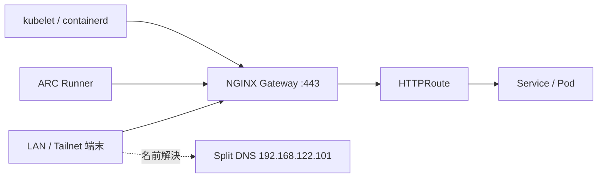

# アクセス経路と公開の追加

経路の照合元は [access-surfaces.yaml](../manifests/contracts/home-lab/access-surfaces.yaml)、
実リソースは [access/](../manifests/access/) です。contract の変更だけでは DNS や Route は生成されません。



## 利用する URL

通常の内部 URL は `https://<名前>.internal.qroksera.com` です。
名前は `argocd`、`harbor`、`rustfs`、`blog`、`cooklog`、`api-hub`、`hitomi-upload-viewer`、
`observability`、`rsshub`、`grafana` が宣言されています。
VMUI は `https://observability.internal.qroksera.com/vmui/` です。

Harbor は push・pull・認証を内部 Gateway `192.168.122.100` で完結させます。
コンソールは `https://harbor.internal.qroksera.com` を LAN / Tailscale 経由で利用します。
cloudflared と専用 Secret / Namespace / Application は撤去しました。
旧 `harbor.qroksera.com` の Route は既存イメージ名との互換用に内部で残しています。
contract の `harbor-external` は旧名であり、exposure は internal です。

RustFS の Gateway backend は console の 9001 のみです。S3 の 9000 はクラスタ内で api-hub などが利用します。
console の `/` は GET / HEAD のリダイレクトと POST / Authorization 付き GET の転送を
[HTTPRoute](../manifests/access/rustfs/manifest.yaml) で分岐しています。

## DNS・TLS・外部設定

| 対象 | 宣言元・役割 |
|---|---|
| 共通 Gateway | [gateway.yaml](../manifests/access/gateway/gateway.yaml)、LB `192.168.122.100` |
| クラスタ内 DNS | [CoreDNS](../manifests/access/dns/core/coredns-configmap.yaml) |
| Tailnet 向け DNS | [Split DNS](../manifests/access/dns/tailscale/manifest.yaml)、LB `192.168.122.101` |
| TLS | [cert-manager 設定](../manifests/infrastructure/security/cert-manager/)、DNS-01、外部 wildcard と内部個別証明書 |
| ノードの名前解決 | [harbor-node-hosts](../manifests/access/harbor/node-hosts.yaml)、両 Harbor hostname を内部 Gateway に固定 |

Gateway の証明書 Secret は `nginx-gateway` namespace に置きます。
内部 hostname でも公開 ACME issuer の DNS-01 を使っています。「内部 URL だから独自 CA を端末へ追加する」とは限りません。

Tailnet 側では `192.168.122.0/24` の subnet route 承認、端末での route 受け入れ、
`internal.qroksera.com` の Split DNS を `.101` に向ける設定が必要です。
DNS の UDP/TCP 53、Gateway の TCP 443（HTTP redirect を使うなら 80）の到達性も確認します。
Harbor internal は CoreDNS と Tailscale Split DNS の両方に登録しています。

GitHub OAuth App の callback は ArgoCD の URL と `/api/dex/callback` を一致させます。
Cloudflare 側の旧 Tunnel / DNS レコードの削除、Tailnet ACL、OAuth App の設定はこのリポジトリから自動反映されません。

## 新しく到達可能な API を追加する手順

1. 公開範囲（クラスタ内 / LAN・Tailnet / Internet）、hostname、backend Service と port、呼び出し元を決めます。
2. [アプリ配布](app-delivery.md) に従って workload / Service / Secret を追加します。
   クラスタ内 Service DNS のみで利用するなら Gateway / hostname の追加は不要です。
3. hostname を使う場合は contract の surface を追加します。`backend`、`gatewayListener`、各 `publish` を指定します。
4. `access/<app>/` に HTTPRoute と Kustomization を追加します。
   annotation `contracts.k8s-myhome.local/access-surface` を surface 名に合わせます。
   `parentRefs.sectionName`、hostname、backend の **Service port** を照合します。
5. 必要な Gateway listener と Certificate を追加します。証明書は cert-manager 配下に置きます。
6. 必要な CoreDNS / Split DNS の hosts と surface annotation を更新します。
   ConfigMap の変更時は Pod template も変更し、新しい設定を読み込ませます。
7. 新しい access Application を `bootstrap/applications/access/` に作り、Kustomization と [一覧](diagrams/app-of-apps-sync-wave.md) に登録します。
8. [NetworkPolicy](network-policy.md) の受信先・送信元と **Pod の待受 port** を確認し、必要な許可を追加します。
9. 静的検証後、Secret / workload の準備、公開経路の同期、クライアントからの実操作を順に確認します。

Service が 80 → 8080 なら HTTPRoute は 80、NetworkPolicy は 8080 です。
既存 HTTPRoute の PathPrefix 内で API のパスだけを追加する場合、接続先・port・公開範囲が変わらなければ
新しい Route は通常不要です。認証・認可はアプリ側で実装します。

## 反映後の確認

```bash
kubectl -n argocd get applications
kubectl -n nginx-gateway get gateway,svc,certificate
kubectl -n <namespace> describe httproute <route-name>
kubectl -n <namespace> get svc,endpointslices
```

Gateway の Programmed、HTTPRoute の Accepted / ResolvedRefs、Certificate の Ready を確認します。
利用端末で DNS と HTTPS、ログイン後の主要操作を確認し、通信制限を追加した場合は拒否される経路も実測します。
初回公開や依存変更の順序を、別 Application の wave だけに依存させないでください。

## Harbor の内部経路と移行

`harbor-access` が kube-system の `harbor-node-hosts` DaemonSet を管理します。
ノードの `/etc/hosts` のみをファイルマウントし、両 Harbor hostname の競合を除去して
`192.168.122.100` に固定します。他のホスト名は保持し、60 秒ごとに再調整します。
containerd の設定・再起動、hostNetwork、privileged は不要です。
Pod DNS は CoreDNS、ARC は既存の hostAliases、ノードはこの DaemonSet を使います。

既存の `harbor.qroksera.com/sandbox/...` はそのまま内部で pull できます。
Harbor の externalURL / EXT_ENDPOINT は内部 hostname に統一し、token realm も内部へ向けます。
両 hostname の証明書検証は維持します。Cloudflare DNS-01 用の Secret は証明書更新に必要なので残します。

移行時は先に DaemonSet の全ノード Ready と両 hostname の内部 HTTPS 到達を確認し、
Harbor・Secret・Split DNS を同期して認証付き pull を確認してから cloudflared を撤去します。
App-of-Apps の sync wave だけで既存 Application の同期完了順を保証しないでください。

DaemonSet を削除しても `/etc/hosts` のエントリは残ります。
ロールバックで外部経路へ戻す場合は、Tunnel の復旧後に DaemonSet を停止し、
全ノードで `# managed: harbor-node-hosts` の行を除去します。
