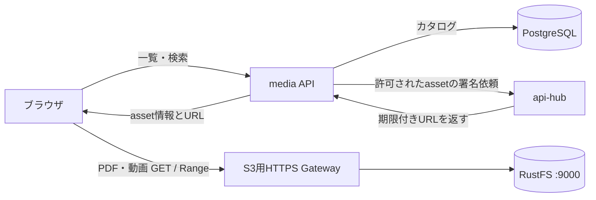

# PostgreSQL導入後のアプリケーション構成レビュー

2026-10-24。対象は `k8s_myHome`、`api-hub`、`hitomi`、`hitomi-pdf-batch`（viewerを含む）、`home-camera`。
利用者からの補足：S3返却の遅さはPDF・動画の両方で発生している。
採用する運用方針：個人サーバーでありSecret管理枠に制約があるため、新規アプリ・Grafana・migrationも既存の共用 `app` roleと資格情報を使う。専用role・専用資格情報の追加は今回の対象にしない。

## 推奨する方向

PostgreSQLには「何を発見し、何を保存し、何に失敗し、何を通知したか」を持たせる。PDF・動画・画像の本体はRustFSに置く。api-hubは資格情報・アクセス許可・通知配送を担当し、大容量ファイルの通常配信は署名付きURLでRustFSへ渡す。

最初に着手するのはPDF・動画の配信経路の計測と改善。その後、DBによるカタログ・項目単位の再試行・通知履歴を導入する。DB追加だけでファイルの転送速度が上がるとは見込まない。

初回の設計レビューはローカルのコード・GitOps宣言を基にしたもの。以後の測定・実装状況は [実装記録](application-implementation-status-20261024.md) を参照。初回レビュー時点では、稼働中Podのimage digest、CPU使用率、NFS性能、実際の転送時間は未確認。以下ではコードから確定できる問題と、計測が必要な仮説を区別する。

| リポジトリ | 確認したHEAD |
|---|---|
| k8s_myHome | `dae5e02` |
| api-hub | `c2f7163` |
| hitomi | `79d8f10` |
| hitomi-pdf-batch | `5d1ea1b` |
| home-camera | `17913c5` |

## 現状で確認できた問題

| 対象 | コード・宣言から確認できた事実 | 影響・評価 |
|---|---|---|
| api-hubの配信 | viewerのPDF・動画URLは `/s3/preview/...`。64KiB単位でストリーミングし、Range・条件付きGET・接続再利用にも対応済み | 「全量バッファリングがviewerの遅延原因」とは断定できない。中継、Gateway、RustFS/NFSを比較する必要がある |
| api-hubのリソース | 1 replica、CPU limit 300m、memory limit 512Mi。Slack処理と大容量転送を同じプロセスで実行 | CPU throttlingや同時転送との競合は仮説。指標を取ってから調整する |
| S3一覧API | `parse_list_objects_v2_request` と `list_objects_v2` が `continuation_token` を扱わない | バッチは次トークンがなくなるまでループするため、100件超で上流が次トークンを返す条件では同じページを取得し続け得る。PDF一覧もページ進行・重複が不正になり得る。DB移行前に修正すべき確定事項 |
| viewer | ランダム表示はprefix全件を取得してから5件を選ぶ。画像失敗時はPDF.js/iframeでPDFを読み込む | オブジェクト数に比例する一覧負荷と、サムネイル失敗に伴う大きな転送が発生する |
| PDFバッチ | PDF50件＋画像50件が全部存在するときだけスキップ。不足が1件でもPDF50件のループを実行 | 再取得・再アップロードを繰り返す。成功した各PDF処理後の60秒待機だけで最大約50分。動画処理も同じJobで先に実行される |
| 動画バッチ | 日付・source・RSSの現在の順位で保存キーを決め、既存キーのMP4シグネチャを見てスキップ | 同日にRSS順位が変わると、同じ順位が同じコンテンツとは限らない。永続的なsource IDが必要 |
| hitomi | フィード項目を毎回処理。一部漫画監視は「昨日の更新」を抽出。送信済みの永続記録がない | 再実行の重複通知や、停止期間中の更新の取りこぼしにつながる。取得済み・通知済みを分離する必要がある |
| バッチの成功判定 | hitomi/PDF・動画の一部失敗はログを出して処理を継続し、全体は正常終了できる | Kubernetes Job成功と業務上の全件成功が一致しない |
| home-camera | 毎時CronJob、`Forbid`、録画3600秒後にアップロード、deadline 3900秒 | 次の毎時境界で前Jobが残り、予定がmissedになる条件がある。後追い起動があっても録画の空白は回収できない |
| home-camera | `/tmp`の録画を保存後に送信。実行経路にアップロード再試行ループがなく、失敗後の再起動は録画からやり直す | `retry.rs`の存在だけでは再送保証にならない。Pod再作成で失う一時ファイルを、DBだけで復元することもできない |
| PostgreSQL | PostgreSQL 18、1 instance、DB 10Gi、backup 20Gi。共用role `app` / DB `registry` をHarborとGrafanaが使用 | 新規アプリはDBを分けて共用roleを継続する。クラスタ全体100接続に加え、`app` の50接続上限を含めた予算調整が必要 |
| ストレージ | RustFS standalone 1 replica、NFS上3Ti。DB本体とpgBackRest repoもNFS上 | RustFSの低速・NFS I/O競合は計測対象。DB本体とbackupの同一媒体障害には現在のbackupだけでは対応できない |
| 保持期間 | `pdfs` / `home-camera-recordings` に30日ライフサイクルを宣言 | DBの保存済みフラグは、30日後の実体存在を保証しない。期限切れの記録と照合処理が必要 |

主な根拠：

- [api-hub server](../../api-hub/src/server.rs)：`write_preview_stream_response`、`request_decoder`、`route_request`。
- [S3 service](../../api-hub/src/service/s3_service.rs)：`get_object_proxy_stream`、`list_objects_v2`、`presigned_get`。
- [S3 handler](../../api-hub/src/handlers/s3_handler.rs)：`parse_list_objects_v2_request`、`put_object_and_notify`。
- [viewer API](../../hitomi-pdf-batch/apps/upload-viewer/src/api.ts)、[PDF画面](../../hitomi-pdf-batch/apps/upload-viewer/src/App.tsx)、[ランダム画面](../../hitomi-pdf-batch/apps/upload-viewer/src/RandomPage.tsx)。動画・ランダム一覧は既に `start_after` でtoken不対応を回避しているが、PDF一覧・バッチはtoken方式が残る。
- [バッチ本体](../../hitomi-pdf-batch/apps/batch/src/main.rs)、[動画キー](../../hitomi-pdf-batch/apps/batch/src/video_batch.rs)、[60秒待機設定](../../hitomi-pdf-batch/apps/batch/src/config.rs)。
- [hitomi本体](../../hitomi/src/main.rs)、[漫画監視の例](../../hitomi/src/comic/sites/shonenjumpplus.rs)。
- [録画本体](../../home-camera/src/main.rs)、[送信処理](../../home-camera/src/storage.rs)、[本番CronJob](../manifests/apps/home-camera/manifest.yaml)。
- [PostgreSQL運用](shared-postgresql.md)、[DB宣言](../manifests/platform/shared-postgresql/postgrescluster.yaml)、[RustFS宣言](../manifests/platform/rustfs/values.yaml)、[保持ルール](../manifests/platform/rustfs/lifecycle.json)。

## PDF・動画の返却を速くする

### 最初の計測

同じPDFとMP4を使い、同じサイズ・Range・並列数・読み取り端末の条件を揃えて比較する。アプリ改修前に稼働image digestと上記HEADの対応も確認する。`:latest`という宣言だけでは、現在読んだ実装が稼働しているとは判断しない。

| 経路 | 測ること |
|---|---|
| 同じ計測Pod → RustFS Service:9000 | 認証付きGETによるRustFS/NFS単体に近い基準値 |
| 同じ計測Pod → api-hub Service:3000 → RustFS | api-hub中継の追加コスト |
| 同じ計測Pod → 内部HTTPS Gateway → api-hub → RustFS | TLS・Gateway経路の追加コスト |
| 実際のブラウザ → 同じ内部HTTPS経路 | クライアント回線、同時要求、描画・デコード時間 |
| S3用HTTPS経路を用意後、同じ端末 → Gateway → RustFS:9000 | 直接配信による改善幅 |

測定は小さなRange（例：先頭1MiB）と全体取得、単発と複数同時、初回と再取得を分ける。TTFB・全体時間・実効MiB/s・転送バイト数・ステータスを記録する。比較試行数を確保してp50/p95を出し、条件が異なる測定値を単純比較しない。

api-hubには既に `upstream_headers_ms` / `transfer_ms` / `bytes_sent` / `request_id` のログがある。前者はS3応答ヘッダーまで、後者は上流読み取りと下流書き込みを含むため、どちらも単独ではNFS待ち・クライアント待ちを特定できない。接続時間、最初の本文バイト、読み取り待ち、書き込み待ち、切断・タイムアウトを追加すると切り分けやすい。転送途中の失敗でも観測値を残す。

既存のVictoriaMetrics・Grafana・Lokiを使い、CPU throttling、メモリ、同時接続数、Gatewayの応答時間、RustFSの要求時間、NFSのread latency/throughput/retransmitを同時に見る。生のobject keyをメトリクスラベルにせず、request IDはログで追跡する。

RustFS直読みから遅ければ、署名URLへの切替だけでは解決しない。NFS媒体・ネットワーク・RustFS配置を調べ、DBのWAL/fsync負荷と大容量メディアI/Oを別ディスクへ分離する案を評価する。api-hub経由だけ遅ければ、中継削減やCPU枠の調整が有力になる。

### 推奨する配信経路

api-hubには署名GET/PUT APIが既にある。必要なのはブラウザ向けの署名設定・経路・アクセス制御・viewerの切替である。

- 現設定のS3 endpointは `http://rustfs-svc.rustfs.svc:9000`。現在の署名URLはこの内部向け設定で生成するので、ブラウザへそのまま返す設計にはできない。
- RustFSの既存HTTPRouteは **consoleの9001** を向く。S3 APIの9000に向ける専用の内部HTTPSホストを追加する。既存console URLの流用は避ける。
- 内部の操作用endpointとブラウザ向け署名endpointを設定上分離する。署名時から最終ホスト・path・queryを使い、Gatewayでも維持する。署名後のホスト文字列置換はしない。
- bucket/keyを任意指定できる署名APIをそのまま閲覧者向けに公開せず、認証済み利用者が読めるasset IDからサーバーが保存先を解決する。GET/HEAD、Range、CORS、証明書を検証する。CORSは認可の代わりにはならない。
- ブラウザのPDF.js等に必要な `Accept-Ranges` / `Content-Range` / `ETag` などをCORSで公開する。通常GETと206、416、再検証、シーク、タブを開いたまま期限切れ後の再取得を確認する。
- URL期限と長時間視聴を両立するため、viewerにURL更新を用意する。Slackには短命URLを永続保存する代わりに、認証後に新しいURLを発行できるassetの固定リンクを載せる。
- 非公開メディアのキャッシュは初期値をprivateとし、上書きするキーには長期immutableを設定しない。版付きキーを導入した後で必要に応じてキャッシュ期間を伸ばす。

[RustFSの公式S3説明](https://github.com/rustfs/docs.rustfs.com/blob/main/content/en/administration/protocols/s3.md)はSigV4・Range・条件付き要求を説明している。ただし実際に配備した版とGatewayでの互換性は検証する。[S3署名URLの公式説明](https://docs.aws.amazon.com/AmazonS3/latest/userguide/using-presigned-url.html)では期限付きGET/PUTが可能で、URLは期限内に再利用できる。

直接配信の経路を用意できない段階は既存proxyを維持する。既に実装されているstreaming・Range・poolを再実装するより、接続/idle timeout、同時転送上限、小さなJSON APIのbody上限を補う。現在の無制限body設定ではBase64/JSON系が全量メモリ読み取りとなり、ダウンロードと競合し得る。CPU limit引上げや別Deploymentへの転送処理分離は、測定結果を見て選ぶ。

PDF/JPEGのアップロードも既存streaming APIへ移す。Base64は本文量を約4/3に増やし、変換・コピーも発生する。ただしviewerの現行GETはBase64 APIを使わないので、これを今回の返却遅延の主原因とは扱わない。

サムネイルは事前生成・保存し、未生成ならプレースホルダーと生成Jobを使う。画像失敗時に一覧全体でPDFを読み込むfallbackを抑える。MP4のfaststartはhome-cameraで既に指定済み。外部取得動画は別途moov位置・再生開始時間を確認し、必要なものだけremuxする。

## アプリケーションの責務とDB

PostgreSQLクラスタと既存の `app` role・資格情報を共有し、論理DBをアプリごとに分ける。各アプリは自分のDBを接続先に指定し、他アプリのテーブルを直接更新しない運用規約とする。同じroleを使うため、DB分割はデータとmigrationの整理であり、アプリ間の権限分離にはならない。最初から全サービスを統合・全面改名せず、現リポジトリ内でAPI/workerの実行モードを追加する。

| 所有者 | 推奨DB | 持つデータ | 実行形態 |
|---|---|---|---|
| api-hub | `api_hub` | object/uploadの技術的台帳、通知受付・配送履歴、冪等キー | API Deployment＋通知worker。同一imageでも起動モードを分けられる |
| hitomi | `hitomi` | source、作品/episode、フィード項目、取得状態、フィルタ判定、通知outbox | 当初は既存CronJob＋DB。必要になれば収集CronJobと取得workerを分離 |
| hitomi-pdf-batch | `media` | PDF/動画カタログ、取得元ID、日付/表示順位、preview、ジョブ、閲覧状態 | planner CronJob＋worker。viewer用media APIを同じrepoに追加 |
| home-camera | `camera` | camera、録画segment、送信状態、実開始/終了、欠落区間 | 常駐recorder＋uploader、永続spool |

api-hubの台帳は保存先・サイズ・checksum等の技術情報、mediaの台帳は作品名・日付・タグ・閲覧状態等の意味を持つ情報とする。object IDで結び、どちらが何を更新するかを明確にする。台帳を二重に持つ負担を避けたい初期段階では、api-hub側はupload sessionと通知に限定し、保存済みassetの台帳はmedia/camera側を正にしてよい。

### api-hub

S3・Slackの資格情報を集約する役割は維持する。追加するのは `POST /notifications`（冪等キー付き、永続化後202）、配送結果の取得、アップロード準備/完了確認、assetに限定した署名発行。

`put_object_and_notify` は現状、S3保存後にSlackへ同期送信し、通知失敗を返すが再配送状態を保存しない。保存と通知を別状態にし、送信失敗だけを再試行できるようにする。

アプリ側は業務状態の更新と「通知してほしい」というoutbox行を**同じDBトランザクション**で確定する。outbox dispatcherがapi-hubへ再送可能な形で届け、api-hubは `(producer, event_id, destination)` 等の一意制約で受付重複を抑止する。別DB間の更新を1つのSQLトランザクションで済むものとして設計しない。

Slack送信は429の `Retry-After`、5xx/通信失敗のbackoff、最大試行回数、手動再送を扱う。成功時はmessage ts/file IDを記録する。外部送信成功とDB記録の間で落ちる可能性は残るため、exactly-onceは約束しない。応答不明の送信を区別し、再送で重複する可能性をUIに示す。[Slack公式のrate limit仕様](https://docs.slack.dev/apis/web-api/rate-limits/)を基準にする。

### hitomi

`sources`、`items`、`episodes`、`processing_jobs`、`notification_outbox` を持たせる。項目はRSS GUIDやsourceの恒久IDを優先し、なければ正規化URLをキーにする。タイトルだけで同一判定しない。

「昨日の項目」だけで処理対象を決めず、前回成功以降の未処理項目を重複しない形で取得する。フィード保持範囲内で少し重ねて取り込み、同じIDはupsertする。フィードから消えた古い項目はDBを導入しても復元できないため、対応サイトに履歴API等がある場合だけbackfillする。再無料化などの再通知はepisode IDにイベント種別・適用期間/版を加えて区別する。

`discovered → fetched → filtered / notification_pending → notified` を区別し、失敗理由・attempts・次回試行時刻を残す。初回移行は直近項目をbaselineとして登録し、過去分を一斉通知しない。NG設定変更で再評価できるよう、判定理由と設定版も保存する。

毎項目の固定60秒待機を取得処理から外し、Slack配送側でrate limitを管理する。外部サイトへの間隔制限は別に維持する。Seleniumは必要な項目だけに使い、まず1 workerから始める。クラスタ内のapi-hub接続を設定化し、該当NetworkPolicyを追加する（現状hitomiは内部HTTPSホスト固定で、他2バッチ向けのService接続許可をそのまま利用できるとは限らない）。

### hitomi-pdf-batchとviewer

`media_items`、`assets`、`ingest_jobs`、`batch_runs`、必要に応じて `user_media_state` を持たせる。PDFとpreviewは別assetで、片方の失敗だけを再取得する。

日付/番号は表示属性にし、取得の同一性は `(source, source_item_id, asset_kind, source_revision)` 等で決める。動画はRSS順位をIDに使わず、各実行の順位snapshotを別に保存する。失敗後に「同日の3位」が別動画に変わっても混ざらないようにする。既存キーは維持してimport可能とし、新規だけUUIDや版付きキーに移行できる。

取得・検証・保存・preview生成を段階化し、ジョブが `ready` になった項目をカタログに公開する。HTTP 200だけでなくPDF/画像/動画形式を確認する。バッチの完了判定は期待件数・成功件数・残件数をDBに保存し、未完了をJob成功で隠さない。404は公開待ちと恒久欠損を期限・試行回数で区別する。

viewerはS3 Listの代わりにmedia APIで日付、種類、タグ、未読、取得失敗を検索する。`(published_at, id)` 等でcursor paginationし、状態・種類・日付に合うindexを作る。ランダム5件もDB側で選ぶ。30日分の小規模データならまず単純な抽選で測り、件数が増えたら抽選用key/indexを使う。`ORDER BY random()`が常に高速とは扱わない。

業務日付をJST等で明示する。現バッチは `TZ=Asia/Tokyo` でも対象日の実装が `OffsetDateTime::now_utc()` なので、TZ指定だけでは日付計算は変わらない。sourceが定義する対象日を仕様化してテストする。

### home-camera

毎時CronJobから、録画対象時間帯を管理する常駐recorderへ変更する。1カメラにつき1 writerとし、まず1 replicaのStatefulSet等でspool PVCを安定して参照する。旧writerと新writerが同時にカメラへ接続しない更新手順を持つ。

録画は1〜5分程度のsegmentへ分け、完成したsegmentをuploaderが並行して送る。`camera_id`、UTCの実開始/終了、sequence/UUID、size、checksum、upload status、attempts、次回再送を保存する。時刻の表示はJST、識別には時刻だけでなくsequence/UUIDも使う。codec copy時のsegment長はkeyframe間隔に影響されるため、実時間を記録する。

DBやS3が一時停止しても録画を継続できるよう、まずPVCへsegmentと小さなmanifestを書き、再開後にDBへ取り込む。未完了ファイルと完成ファイルを区別し、起動時にspoolを照合する。spool容量上限、送信遅延アラート、満杯時に古い未送信を捨てるか録画を止めるかの方針を明示する。ローカルPVCならノード障害時に移動できない制約もある。

例えば4Mbps、録画14時間/日なら約25.2GB/日・30日で約756GB/カメラ（音声等を除く）。実ビットレートからspoolとRustFS容量を見積もる。映像処理やDB接続の追加より、録画と転送を分離して欠落を減らす効果が大きい。

[Kubernetes公式](https://kubernetes.io/docs/concepts/workloads/controllers/cron-jobs/)でも `Forbid` と前回Jobの重なりによるmissed schedule、CronJob処理の冪等性が説明されている。`Allow`へ変えるだけでは複数録画・キー衝突・資源競合が残る。

## 最小の永続化設計

以下は論理モデルであり、そのまま適用するmigration SQLではない。共通の形をライブラリで揃えつつ、各DBのmigrationは所有アプリが管理する。

| データ | 最低限の属性・制約 |
|---|---|
| source item | `id, source, external_id, source_revision, discovered_at, status`。source IDと版に一意制約 |
| asset | `id, item_id, kind, bucket, object_key, size, checksum, source_revision, state, stored_at, expires_at, last_verified_at`。保存先と版を識別。S3 ETagは別属性として保持し、multipart ETagをSHA-256とみなさない |
| job | `id, dedupe_key, kind, payload, state, attempts, next_attempt_at, lease_until, claim_token, last_error`。dedupe keyの一意制約、実行待ちに絞ったindex |
| notification | `producer, event_id, destination, state, next_attempt_at, attempts, slack_ts, last_error`。producer/event/destinationに一意制約 |
| recording | `id, camera_id, actual_start_at, actual_end_at, spool_path, object_key, size, checksum, state`。segment IDに一意制約 |
| run | `id, producer, scheduled_at, started_at, ended_at, expected, succeeded, failed, status`。Jobのexit codeと業務完了を結び付ける |

### ジョブ実行

家庭用規模の初期案はPostgreSQLのジョブテーブルで十分。Kafkaや別の共有Redis queueを最初から追加する根拠はまだない。既存RSSHub/HarborのRedisはそれぞれの用途に維持する。

1. 短いトランザクションで、期限が来たジョブを `FOR UPDATE SKIP LOCKED` により取得する。
2. `running`、lease期限、一意なclaim token、attemptsを更新してcommitする。
3. DB接続・行ロックを解放してからHTTP取得・変換・アップロードを行う。
4. 長い処理はleaseを更新する。完了/失敗更新はclaim tokenが一致する場合に限る。
5. lease切れを回収する。期限切れ後に戻った旧workerの副作用を考え、外部保存も冪等キーや試行ごとの保存先で保護する。

`SKIP LOCKED` は複数consumerのqueue用途に使えるが、単独で再配送や重複排除を実装するものではない。[PostgreSQL公式](https://www.postgresql.org/docs/18/sql-select.html)。定期pollを回復の基準にし、LISTEN/NOTIFYは必要になった場合の起床通知に留める。

### DBとS3の整合性

DBトランザクションとS3 PUTは原子的にcommitできない。以下の途中状態を回収できるようにする。

1. DBでupload intentと予定keyを確定する。
2. workerがstreaming、または期限付きPUT/multipart URLで送信する。
3. api-hub等の完了確認APIがHEADや必要なchecksum検証を行う。クライアントの「成功した」という申告だけでreadyにしない。
4. 所有DBでassetをreadyにし、必要ならoutboxを同じトランザクションで追加する。
5. S3成功後DB更新前の停止はintentを基に照合して回復する。長期pending、孤立object、不完全multipart uploadを定期整理する。

checksumの対応範囲は配備したRustFSで確かめる。署名PUTの利用者には予約したkeyだけを許可し、内容サイズ・形式・所有者を完了時に確認する。

現行の30日ライフサイクルは当初維持する。`expires_at`は削除予定として扱い、実削除は非同期であることを踏まえる。404と一時障害を区別し、定期照合で `missing/expired` を更新する。期限切れを「取得失敗」とみなして際限なく再ダウンロードしない。再取得は明示的な操作にする。

お気に入りの永久保存を追加する場合は、現在の全prefix対象ルールでは保護されない。専用archive bucketへコピーする等の保持方針を先に決める。

## k8s_myHome側の変更

### PostgreSQLをアプリ向けに整える

- `api_hub` / `hitomi` / `media` / `camera` のDBを追加し、所有roleは既存の `app` に揃える。runtimeとmigrationも同じroleを使う。DB作成・所有者設定はPGO/既存の管理処理で行い、`app` のNOSUPERUSER/NOCREATEDB/NOCREATEROLEを維持する。PUBLICのCONNECT/TEMP等は確認し、必要な接続権限を `app` に与える。
- Grafanaも既存の `app` と資格情報を継続する。ダッシュボードのSQLは統計・公開view等への読み取り用途に限定する運用とし、DB権限として読み取り専用になったとは扱わない。Harborを含めて同じroleのため、資格情報ローテーションは全利用側を対象に計画する。
- Secret管理に新しい資格情報の項目を追加せず、既存のESO入力とPGOの `app` 資格情報を再利用する。必要なnamespaceへ同じ資格情報を配布し、現credentials reconcilerのCA配布先（harbor/observability）にsandbox等を追加する。namespaceごとに必要なKubernetes Secretは同じ資格情報の配布先として扱う。
- `sslmode=verify-full`、CA mount、最小限のNetworkPolicyを用意する。DBを作るだけでは現在のネットワーク制御を越えて接続できない。
- 接続poolは小さく始める。例：api-hub API 3、通知worker 2、media API 3、media worker 2、hitomi 2、camera uploader 2で合計14。全Deploymentが一時的に倍になる保守的見積りでは28。既存Harborのrollout最大40＋Grafana 5と合わせ73となり、現行の `app CONNECTION LIMIT 50` を超える。実Pod数・pool・同時rolloutを見直したうえで、必要なら `app` 上限を例えば80へ調整する案とする。クラスタ全体100の中で管理・監視用接続を確保し、`app` を使うmigrationも80側の予算に含める。この数値は仮予算であり、変更前に実接続数とメモリ使用量で検証する。
- workerは外部HTTP待機中にDB接続を保持しない。接続不足が実測されたらPgBouncerを検討する。DBのメモリlimit 1Giに対して、max_connectionsだけを増やす対応は避ける。
- migrationは専用Jobで一度実行し、新旧バージョン併存可能な追加変更から入れる。PGO/DB準備、migration、アプリの順序と各Application内の同期条件を定義する。

### 保存と可用性

現構成はPostgreSQL 1 instance、RustFS 1 replicaで、DB本体とpgBackRest repoは同じNFS。別媒体/別ホストへのbackupは実施できないとの利用者指示により今回の対象外とし、切替の前提にはしない。既存のpgBackRest backupと復元手順・試験は維持する。

DBをSSD等へ移す案は、大容量メディアとfsyncの競合を減らせる可能性がある。一方、local PVではノード固定と復旧手順が必要になる。物理的に同じホスト・媒体上へreplicaだけ増やしても、障害領域は分離できない。容量、I/O、必要な復旧時間を見て判断する。

DBのPITRとS3側の30日削除は同じ時点へ戻らない。復元後はasset存在照合を行い、通知workerを止めた状態で古いpending/sent記録を評価する。過去の通知が再送される可能性を考慮してからworkerを再開する。

### GitOpsへの組み込み

既存アプリは `manifests/apps/<app>/` と各repoのコードを更新する。新しいmedia API等を独立Applicationにする場合は `manifests/apps/<app>/` と `manifests/bootstrap/applications/user-apps/<app>-app.yaml` をセットで登録する。公開経路は現在存在する `manifests/access/`、ExternalSecretは `manifests/platform/secrets/external-secrets/` に置く。

直接S3に接続するworkerを追加した場合は、現在の「api-hubのみS3へ接続」のNetworkPolicyも両方向から見直す。S3 GatewayからRustFS:9000への許可、hitomiからapi-hub Serviceへの許可、アプリからDBへの許可を個別に追加する。

CronJobには `timeZone` と再実行規則を明示する。Podの生存/待受と業務準備状態を区別するprobe、CPU/memory/ephemeral-storage、spool PVCを設定する。image digestを追跡できるtagへ切り替え、計測結果と配備版を対応付ける。

実コードにはRTSP資格情報を含むURLのマニフェスト直書きとURL全体のログ出力もある。録画構成を変更する際にSecret参照へ移し、ログでは資格情報部分を伏せる。hitomiのapi-hub接続は証明書検証無効のclientを使っているため、内部Service接続またはCAを使う検証可能なHTTPSへ揃える。

## 実装順と完了条件

| 順序 | 小さく分けた変更 | 完了条件 |
|---|---|---|
| 1 | 配備版の確認、PDF/動画の3経路比較、既存転送ログの集計。S3 pagination修正は独立PR | 遅延をTTFB/転送/描画に分けられる。100件超の一覧で全件を重複・無限loopなく取得できる |
| 2 | S3用HTTPS経路、ブラウザ向け署名設定、viewerの直接配信切替 | 同じPDF/動画で旧経路との改善幅を確認。Range/シーク/期限切れ再発行/CORSが動作。署名が対象外objectを許可しない |
| 3 | アプリ別DB、既存app資格情報の配布、CA/接続予算、アプリmigration基盤 | 全アプリがappで正しいDBへ接続できる。appとクラスタ全体の接続上限、既存backup方式のrestoreを検証できる |
| 4 | media DB＋API、既存S3からのimport、項目単位のバッチ再試行 | 一覧がS3 List不要。PDFのみ/previewのみの欠損を個別修復。RSS順位変更でも同一動画のIDが変わらない |
| 5 | api-hub通知queueとhitomiの永続状態/outbox | 同じイベント再受付で通知ジョブが増殖しない。Slack失敗・worker再起動から回復。過去分を誤って一斉通知しない |
| 6 | home-cameraの常駐segment録画＋spool＋再送 | 通常のsegment境界とupload中に録画が継続。S3/DB停止中もspool内で録画し、復帰後に再送できる |
| 7 | 既存viewerの管理機能拡張 | 欠損・再送・保存期限をUIで扱い、運用ログの手作業検索が減る |

配信の目標値は実測前の仮値として、同じ環境で直接取得に対する転送性能の低下を例えば10〜20%以内、一覧API p95を例えば200ms以内、PDF初回表示/動画再生開始を端末別に設定する。到達済みの性能値ではなく、初回測定後に現実的な基準へ更新する。

移行は既存S3キーを壊さず、対象bucket/prefixを限定してimportする。既存objectのサイズ・ETag・保存時刻・keyから分かる属性だけを登録し、過去のsource IDや通知履歴が復元不能ならunknownとして扱う。PDF/MP4の内容検証とカタログ登録済みを区別する。

旧writerと新writerを同時に動かして同一対象を処理させない。先にDBへの記録と既存一覧の比較を行い、その後カタログ読み取りを切り替える。必要な比較期間は機能フラグで旧proxy/旧一覧へ戻せるようにする。新形式assetを旧一覧が表示できるかも切替前に検証し、戻すために新DBやobjectを削除しない。

実装時の重点テストは、S3成功直後/DB更新前の停止、Slack成功直後/結果保存前の停止、lease期限切れ後の旧worker復帰、100件超のページ送り、30日削除後の表示、URL期限切れ後のRange再要求、DB/S3停止中の録画である。マニフェスト変更時はリポジトリの `automation/scripts/ci/validate.sh` と必要なアプリCIを実行する。初回レビュー後の実装・測定・未配備事項は [実装記録](application-implementation-status-20261024.md) にまとめる。
