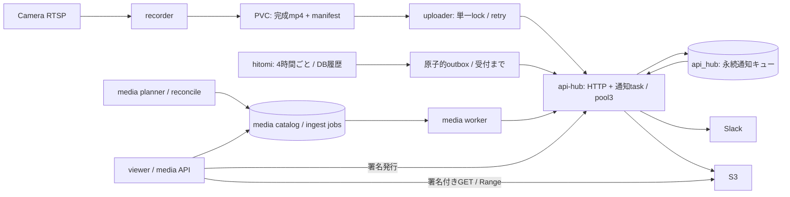

# 簡素化後のアプリ構成

GitOps・digest固定・共有PostgreSQL・既存資格情報/監視は維持する。cameraのDBキュー、通常同期import、hitomiの配送ポーリング、専用通知worker、旧録画/一括取得/DBなしfallbackを撤去した。

| 管理対象 | 変更前 | 最終構成 |
|---|---:|---:|
| 対象アプリの常駐Pod | 6 | 5 |
| そのcontainer数 | 7 | 6 |
| 主処理のDB pool上限合計 | 18 | 14 |
| Harbor/Grafana・運用Job・rolloutを含むapp最大見積り | 78 | 70 |
| cameraのDB接続 | 2 | 0 |
| api-hub API+配送 | 別Pod / 3+2 | 同一Pod / 共有3 |
| 通常同期のmedia import | PostSync | なし（明示Jobのみ） |

pool合計14はAPI3+media API3/worker2/planner2+hitomi収集2/outbox2。毎時reconcile/明示import/資格情報Job等は最大見積りへ別計上する。Pod数には定期・明示Jobと共有DB/基盤を含めない。cameraの2containerは別プロセスのまま維持する。

実運用と残る取得失敗・最終digestは[実行記録](application-simplification-20261025.md)、復元・切戻しは[運用手順](application-postgresql-cutover.md)を参照。
