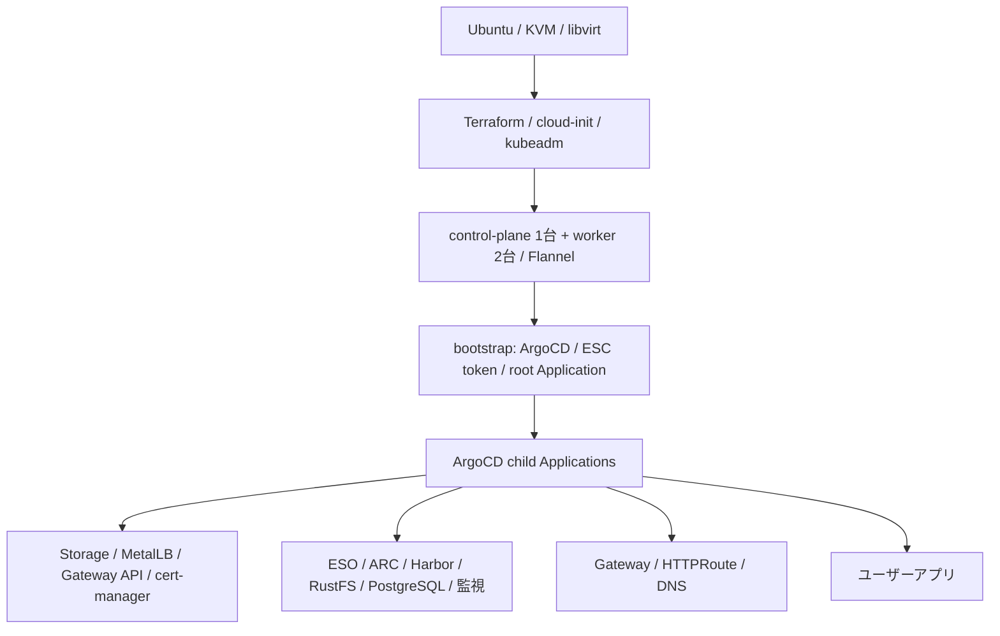

# 全体構成

Ubuntu ホスト上の libvirt VM に kubeadm クラスタを構築し、ArgoCD が基盤とアプリを管理します。
VM・OS 準備はローカルスクリプトと Terraform、Kubernetes リソースの継続管理は GitOps が担当します。

## ノード・ネットワーク

[Terraform 変数](../automation/infrastructure/variables.tf) と
[cluster contract](../manifests/contracts/home-lab/cluster-contract.yaml) の宣言値です。

| 対象 | 宣言 |
|---|---|
| control-plane | `k8s-control-plane` / `192.168.122.10` |
| workers | `k8s-worker1` / `.11`、`k8s-worker2` / `.12`（同じ `192.168.122.0/24`） |
| VM 既定リソース | 各 4 vCPU / 6144 MiB、CPU mode は `host-model` |
| Pod / Service CIDR | `10.244.0.0/16` / `10.96.0.0/12` |
| MetalLB | `192.168.122.100-192.168.122.150`、L2 |
| Gateway / Split DNS | `192.168.122.100` / `192.168.122.101` |
| NFS | `192.168.122.1:/mnt/k8s-storage/nfs-share` |

Flannel は [Terraform](../automation/infrastructure/main.tf) が導入します。
NetworkPolicy の実行は別の [kube-network-policies DaemonSet](../manifests/infrastructure/networking/kube-network-policies/manifest.yaml) が担当します。
control-plane、NFS、単一 replica のサービスを含むため、構成全体が冗長化されているとは扱いません。

## 基盤と依存先

| 領域 | 実装と用途 |
|---|---|
| GitOps | ArgoCD 本体・設定の自己管理、AppProject、ApplicationSet |
| 認証情報 | ESO → Pulumi ESC。初回の ESC token は bootstrap が投入 |
| 公開 | NGINX Gateway Fabric + cert-manager。Harbor を含む内部接続は LAN / Tailscale 経路 |
| レジストリ・CI | Harbor、ARC。アプリの build workflow はアプリ側リポジトリに配置 |
| データ | RustFS（S3）、PGO 管理の共通 PostgreSQL（Harbor DB と Grafana の SQL 接続先） |
| 監視 | VictoriaMetrics / kube-state-metrics / vmalert / Alertmanager / Grafana / Loki / Alloy |

Grafana 自体の永続データは local-path PVC に保存します。PostgreSQL は Grafana の SQL データソースです。
ストレージの保持方針は [配置規約](manifests.md)、通信経路は [アクセス経路](access.md)、
適用定義は [Application 一覧](diagrams/app-of-apps-sync-wave.md) を参照してください。

## リポジトリ外の設定

Pulumi ESC の値、Cloudflare の DNS、Tailscale の route 承認・DNS・ACL、GitHub OAuth App・GitHub App の設定、
NFS 上の既存データは Git の YAML だけでは復元できません。初回構築では [bootstrap](bootstrap.md) と [secrets](secrets.md) を併せて確認します。
