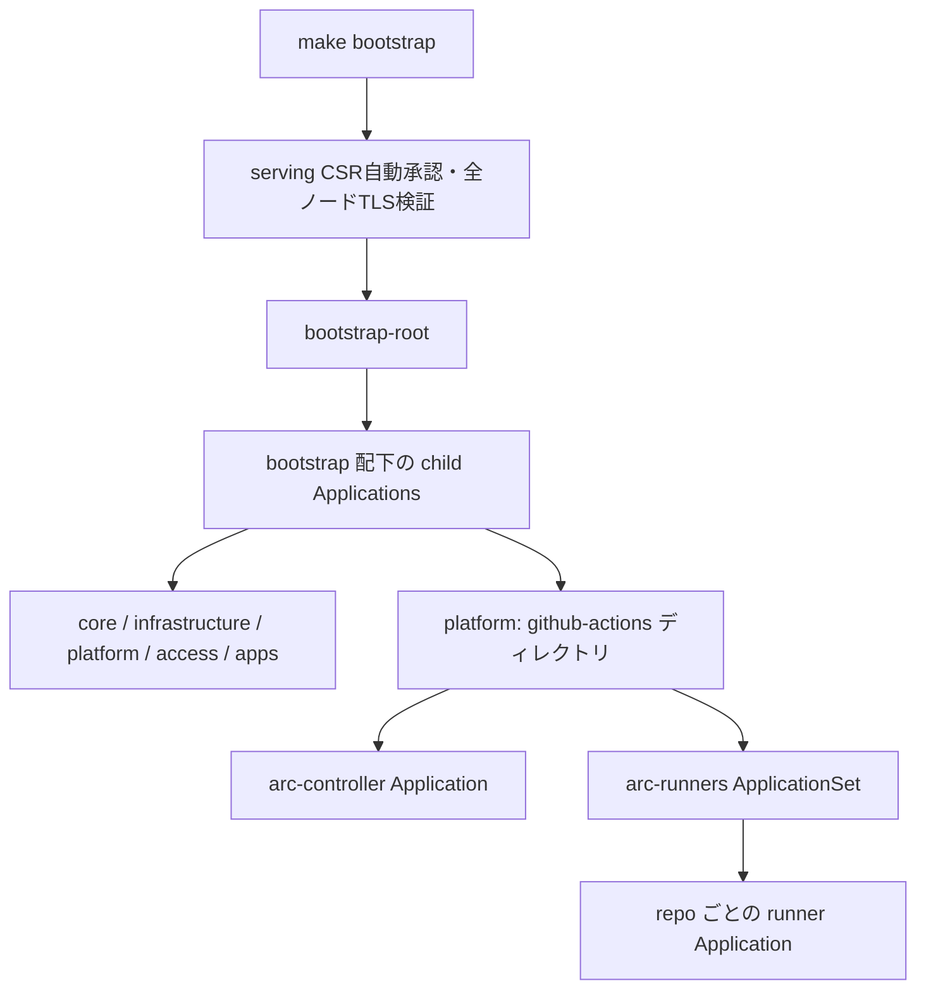

# Application と Sync Wave

2026-10-20 の [bootstrap 定義](../../manifests/bootstrap/applications/) から作成した一覧です。
root は [bootstrap-root](../../manifests/bootstrap/app-of-apps.yaml) で、source は `manifests/bootstrap/applications` です。

## 管理構造

## root が同期する Application

wave は root が作成・更新する Application の annotation です。別 Application の内部リソースまで
一括した完了順序を保証する値ではありません。同じ wave 内の依存にも Ready / 実動作の確認が必要です。

| Wave | Application（定義） | Project | Source | Destination namespace |
|---|---|---|---|---|
| 0 | [argocd-projects](../../manifests/bootstrap/applications/core/argocd-projects.yaml) | `default` | [manifests/platform/argocd-config](../../manifests/platform/argocd-config) (`include: argocd-projects.yaml`) | `argocd` |
| 1 | [argocd-core](../../manifests/bootstrap/applications/platform/argocd-core.yaml) | `platform` | [manifests/platform/argocd-config](../../manifests/platform/argocd-config) | `argocd` |
| 1 | [local-path-provisioner](../../manifests/bootstrap/applications/infrastructure/local-path-provisioner.yaml) | `infrastructure` | [manifests/infrastructure/storage/local-path](../../manifests/infrastructure/storage/local-path) | `local-path-storage` |
| 1 | [nfs-subdir-external-provisioner](../../manifests/bootstrap/applications/infrastructure/nfs-subdir-external-provisioner.yaml) | `infrastructure` | Helm `nfs-subdir-external-provisioner`（版は定義を参照） | `nfs-storage` |
| 1 | [kubelet-serving-certificates](../../manifests/bootstrap/applications/infrastructure/kubelet-serving-certificates.yaml) | `infrastructure` | [manifests/infrastructure/security/kubelet-serving-certificates](../../manifests/infrastructure/security/kubelet-serving-certificates) | `kube-system` |
| 2 | [core](../../manifests/bootstrap/applications/core/core.yaml) | `core` | [manifests/core](../../manifests/core) | `指定なし` |
| 3 | [kube-network-policies](../../manifests/bootstrap/applications/infrastructure/kube-network-policies.yaml) | `infrastructure` | [manifests/infrastructure/networking/kube-network-policies](../../manifests/infrastructure/networking/kube-network-policies) | `kube-system` |
| 3 | [metallb](../../manifests/bootstrap/applications/infrastructure/metallb.yaml) | `infrastructure` | Helm `metallb`（版は定義を参照） | `metallb-system` |
| 4 | [metallb-config](../../manifests/bootstrap/applications/infrastructure/metallb-config.yaml) | `infrastructure` | [manifests/infrastructure/networking/metallb](../../manifests/infrastructure/networking/metallb) (`include: metallb-ipaddress-pool.yaml`) | `metallb-system` |
| 5 | [gateway-api](../../manifests/bootstrap/applications/infrastructure/gateway-api.yaml) | `infrastructure` | [manifests/infrastructure/networking/nginx-gateway-fabric/gateway-api](../../manifests/infrastructure/networking/nginx-gateway-fabric/gateway-api) | `nginx-gateway` |
| 6 | [nginx-gateway-fabric](../../manifests/bootstrap/applications/infrastructure/nginx-gateway-fabric.yaml) | `infrastructure` | Helm `nginx-gateway-fabric`（版は定義を参照） | `nginx-gateway` |
| 7 | [cert-manager](../../manifests/bootstrap/applications/infrastructure/cert-manager.yaml) | `infrastructure` | Helm `cert-manager`（版は定義を参照） | `cert-manager` |
| 7 | [cert-manager-config](../../manifests/bootstrap/applications/infrastructure/cert-manager-config.yaml) | `infrastructure` | [manifests/infrastructure/security/cert-manager](../../manifests/infrastructure/security/cert-manager) | `cert-manager` |
| 7 | [external-secrets-operator](../../manifests/bootstrap/applications/platform/external-secrets-operator.yaml) | `platform` | Helm `external-secrets`（版は定義を参照） | `external-secrets-system` |
| 8 | [gateway-shared](../../manifests/bootstrap/applications/access/gateway-shared.yaml) | `access` | [manifests/access/gateway](../../manifests/access/gateway) | `nginx-gateway` |
| 8 | [pgo](../../manifests/bootstrap/applications/platform/pgo.yaml) | `platform` | [manifests/platform/pgo](../../manifests/platform/pgo) | `postgres-operator` |
| 9 | [config-secrets](../../manifests/bootstrap/applications/platform/config-secrets.yaml) | `platform` | [manifests/platform/secrets/external-secrets](../../manifests/platform/secrets/external-secrets) | `external-secrets-system` |
| 10 | [platform](../../manifests/bootstrap/applications/platform/platform.yaml) | `platform` | [manifests/platform/ci-cd/github-actions](../../manifests/platform/ci-cd/github-actions) | `argocd` |
| 10 | [reloader](../../manifests/bootstrap/applications/platform/reloader.yaml) | `platform` | [manifests/platform/reloader](../../manifests/platform/reloader) | `kube-system` |
| 10 | [rustfs](../../manifests/bootstrap/applications/platform/rustfs.yaml) | `platform` | [manifests/platform/rustfs](../../manifests/platform/rustfs) | `rustfs` |
| 10 | [shared-postgresql](../../manifests/bootstrap/applications/platform/shared-postgresql.yaml) | `platform` | [manifests/platform/shared-postgresql](../../manifests/platform/shared-postgresql) | `database` |
| 10 | [tailscale-operator](../../manifests/bootstrap/applications/infrastructure/tailscale-operator.yaml) | `infrastructure` | Helm `tailscale-operator`（版は定義を参照） | `tailscale` |
| 11 | [harbor](../../manifests/bootstrap/applications/platform/harbor.yaml) | `platform` | [manifests/platform/harbor](../../manifests/platform/harbor) | `harbor` |
| 11 | [observability](../../manifests/bootstrap/applications/platform/observability.yaml) | `platform` | [manifests/platform/observability](../../manifests/platform/observability) | `observability` |
| 11 | [sandbox-config](../../manifests/bootstrap/applications/platform/sandbox-config.yaml) | `platform` | [manifests/platform/shared-config/sandbox](../../manifests/platform/shared-config/sandbox) | `sandbox` |
| 11 | [tailscale-connector](../../manifests/bootstrap/applications/infrastructure/tailscale-connector.yaml) | `infrastructure` | [manifests/infrastructure/networking/tailscale-operator](../../manifests/infrastructure/networking/tailscale-operator) | `tailscale` |
| 12 | [api-hub](../../manifests/bootstrap/applications/user-apps/api-hub-app.yaml) | `apps` | [manifests/apps/api-hub](../../manifests/apps/api-hub) | `sandbox` |
| 12 | [blog](../../manifests/bootstrap/applications/user-apps/blog-app.yaml) | `apps` | [manifests/apps/blog](../../manifests/apps/blog) | `sandbox` |
| 12 | [cooklog](../../manifests/bootstrap/applications/user-apps/cooklog-app.yaml) | `apps` | [manifests/apps/cooklog](../../manifests/apps/cooklog) | `sandbox` |
| 12 | [hitomi](../../manifests/bootstrap/applications/user-apps/hitomi-app.yaml) | `apps` | [manifests/apps/hitomi](../../manifests/apps/hitomi) | `sandbox` |
| 12 | [hitomi-pdf](../../manifests/bootstrap/applications/user-apps/hitomi-pdf-app.yaml) | `apps` | [manifests/apps/hitomi-pdf](../../manifests/apps/hitomi-pdf) | `sandbox` |
| 12 | [hitomi-upload-viewer](../../manifests/bootstrap/applications/user-apps/hitomi-upload-viewer-app.yaml) | `apps` | [manifests/apps/hitomi-upload-viewer](../../manifests/apps/hitomi-upload-viewer) | `sandbox` |
| 12 | [home-camera](../../manifests/bootstrap/applications/user-apps/home-camera-app.yaml) | `apps` | [manifests/apps/home-camera](../../manifests/apps/home-camera) | `sandbox` |
| 12 | [rsshub](../../manifests/bootstrap/applications/user-apps/rsshub-app.yaml) | `apps` | [manifests/apps/rsshub](../../manifests/apps/rsshub) | `sandbox` |
| 12 | [selenium](../../manifests/bootstrap/applications/user-apps/selenium-app.yaml) | `apps` | [manifests/apps/selenium](../../manifests/apps/selenium) | `tools` |
| 13 | [api-hub-access](../../manifests/bootstrap/applications/access/api-hub-access.yaml) | `access` | [manifests/access/api-hub](../../manifests/access/api-hub) | `sandbox` |
| 13 | [argocd-access](../../manifests/bootstrap/applications/access/argocd-access.yaml) | `access` | [manifests/access/argocd](../../manifests/access/argocd) | `argocd` |
| 13 | [blog-access](../../manifests/bootstrap/applications/access/blog-access.yaml) | `access` | [manifests/access/blog](../../manifests/access/blog) | `sandbox` |
| 13 | [cooklog-access](../../manifests/bootstrap/applications/access/cooklog-access.yaml) | `access` | [manifests/access/cooklog](../../manifests/access/cooklog) | `sandbox` |
| 13 | [harbor-access](../../manifests/bootstrap/applications/access/harbor-access.yaml) | `access` | [manifests/access/harbor](../../manifests/access/harbor) | `harbor` |
| 13 | [hitomi-upload-viewer-access](../../manifests/bootstrap/applications/access/hitomi-upload-viewer-access.yaml) | `access` | [manifests/access/hitomi-upload-viewer](../../manifests/access/hitomi-upload-viewer) | `sandbox` |
| 13 | [observability-access](../../manifests/bootstrap/applications/access/observability-access.yaml) | `access` | [manifests/access/observability](../../manifests/access/observability) | `observability` |
| 13 | [rsshub-access](../../manifests/bootstrap/applications/access/rsshub-access.yaml) | `access` | [manifests/access/rsshub](../../manifests/access/rsshub) | `sandbox` |
| 13 | [rustfs-access](../../manifests/bootstrap/applications/access/rustfs-access.yaml) | `access` | [manifests/access/rustfs](../../manifests/access/rustfs) | `rustfs` |
| 14 | [cloudflared](../../manifests/bootstrap/applications/access/cloudflared.yaml) | `access` | [manifests/access/cloudflared](../../manifests/access/cloudflared) | `cloudflared` |
| 14 | [dns-core](../../manifests/bootstrap/applications/access/dns-core.yaml) | `access` | [manifests/access/dns/core](../../manifests/access/dns/core) | `kube-system` |
| 14 | [dns-tailscale](../../manifests/bootstrap/applications/access/dns-tailscale.yaml) | `access` | [manifests/access/dns/tailscale](../../manifests/access/dns/tailscale) | `tailscale` |

root 配下は **47 Application**。`argocd-projects` / `argocd-core` のみ automated prune が false、他は true です。
ローカル Git source は `HEAD`、外部 chart は固定 revision です。

## ARC が追加する Application

[platform の Kustomization](../../manifests/platform/ci-cd/github-actions/kustomization.yaml) は
[arc-controller](../../manifests/platform/ci-cd/github-actions/arc-controller.yaml) と
[arc-runners ApplicationSet](../../manifests/platform/ci-cd/github-actions/runners-appset.yaml) を管理します。
arc-controller は wave の明示なし、prune false。Runner template は wave 9 / prune true です。
これらを root の wave 9 と同じ同期段階と解釈しません。

| 生成 Application | GitHub repo | Runner 名 | min / max |
|---|---|---|---|
| `blog-runner` | `ksera524/blog` | `blog-runners` | 0 / 1 |
| `cooklog-runner` | `ksera524/cookLog` | `cooklog-runners` | 0 / 1 |
| `hitomi-runner` | `ksera524/hitomi` | `hitomi-runners` | 0 / 1 |
| `api-hub-runner` | `ksera524/api-hub` | `api-hub-runners` | 0 / 1 |
| `home-camera-runner` | `ksera524/home-camera` | `home-camera-runners` | 0 / 1 |
| `hitomi-pdf-batch-runner` | `ksera524/hitomi-pdf-batch` | `hitomi-pdf-batch-runners` | 0 / 1 |
| `rsshub-private-runner` | `ksera524/RSSHub-private` | `rsshub-private-runners` | 0 / 1 |

## 確認する依存

- kubelet serving 証明書 → root Application。初回は bootstrap が承認処理を導入・検証し、以降は `kubelet-serving-certificates` が所有します。
- CRD → controller / Custom Resource。cert-manager 本体と設定は同じ wave 7 です。
- ESO → config-secrets → 証明書や workload が使う Secret。
- PGO → shared-postgresql → 資格情報・CA・復元マーカー → Harbor。
- workload → HTTPRoute → DNS / Tunnel。Gateway の Programmed と実クライアントの疎通を確認します。

Application を変更したら、この一覧・Runner 表・関連する運用ページを合わせて更新します。
同期状態の確認と切り戻しは [GitOps](../gitops.md) を参照してください。
