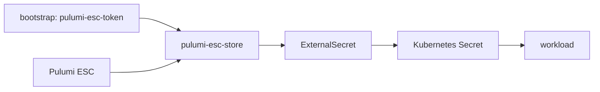

# Secret 管理

ESO 本体は [external-secrets-operator Application](../manifests/bootstrap/applications/platform/external-secrets-operator.yaml) の
外部 Helm chart と inline values が正本です。
`config-secrets` は [Kustomization](../manifests/platform/secrets/external-secrets/kustomization.yaml) から
Store / ExternalSecret / generator を管理します。



[Store](../manifests/platform/secrets/external-secrets/stores/pulumi-esc-secretstore.yaml) は
organization `ksera` / project `k8s` / environment `secret`、token の参照先は
`external-secrets-system/pulumi-esc-token` の `accessToken` です。
ローカル設定の environment を変えるだけではこのマニフェストは変わりません。

## 入力を用意する

値は ESC に登録し、Git には参照とテンプレートだけを置きます。
具体的なキー構造は各 domain の `remoteRef.key` / `property` / `dataFrom` が正本です。

| domain | 主な入力・用途 |
|---|---|
| [argocd](../manifests/platform/secrets/external-secrets/argocd/) | `argocd` の `client-secret`、`alertmanager-slack-webhook-url` |
| [harbor](../manifests/platform/secrets/external-secrets/harbor/) | `harbor.admin_password`、内部認証、namespace ごとの pull Secret |
| [github-actions](../manifests/platform/secrets/external-secrets/github-actions/) | `github` の GitHub App 情報、Harbor push 認証 |
| [networking](../manifests/platform/secrets/external-secrets/networking/) | `dns-01`、`cloudflared`、`tailscale.client_id` / `client_secret` |
| [app-runtime](../manifests/platform/secrets/external-secrets/app-runtime/) | `slack`、`rustfs.access_key` / `secret_key` |
| [observability](../manifests/platform/secrets/external-secrets/observability/) | Slack Webhook、PostgreSQL 共用パスワード、Grafana 初期管理者 generator |
| [postgresql](../manifests/platform/secrets/external-secrets/postgresql/) | `postgresql.admin_password` / `postgresql.password` |

`cloudflared` は Secret の `token` から **credentials.json としてファイルにマウント**されます。
Deployment は `--token` モードではないため、名前だけを見て Tunnel token 文字列を入れず、
[設定](../manifests/access/cloudflared/cloudflared-config.yaml) の tunnel と一致する credentials JSON を用意します。

## 反映・ローテーション

1. ESC の値と ExternalSecret の参照を揃えます。
2. 定義変更がある場合は Git 検証・反映を行います。
3. Store と ExternalSecret の Ready、target Secret の存在を確認します。
4. 値を利用するプロセスが設定を読み直したことを確認します。

```bash
kubectl get clustersecretstores
kubectl describe clustersecretstore pulumi-esc-store
kubectl get externalsecrets -A
kubectl -n <namespace> describe externalsecret <name>
```

周期同期の ExternalSecret を即時に再確認させる場合:

```bash
kubectl -n <namespace> annotate externalsecret <name> force-sync="$(date +%s)" --overwrite
```

同期間隔は各 manifest に従います。Grafana 初期管理者は `CreatedOnce` なので周期的なローテーションの対象ではありません。
ArgoCD の `argocd-secret` / `argocd-notifications-secret` は `creationPolicy: Merge` で、upstream が作る Secret が必要です。
環境変数で読む Secret は更新だけで既存プロセスに反映されないため、[Reloader の監視範囲](platform-extensions.md) も確認します。

## Harbor 内部認証情報

[harbor-internal-secret](../manifests/platform/secrets/external-secrets/harbor/harbor-internal-secret.yaml) を
[values.yaml](../manifests/platform/harbor/values.yaml) から参照し、chart 描画ごとのランダム生成を避けます。

| ESC の `harbor` 配下 | Secret キー |
|---|---|
| `core_secret` / `encryption_key` | `secret` / `secretKey` |
| `token_cert` / `token_key` | `tls.crt` / `tls.key` |
| `xsrf_key` / `jobservice_secret` | `CSRF_KEY` / `JOBSERVICE_SECRET` |
| `registry_secret` | `REGISTRY_HTTP_SECRET` |
| `registry_password` / `registry_htpasswd` | `REGISTRY_PASSWD` / `REGISTRY_HTPASSWD` |

証明書と秘密鍵、password と htpasswd の整合を維持します。暗号化キーの変更は保存済みデータへの影響を確認します。
Harbor namespace は現行 Reloader の監視対象外なので、annotation があっても自動再起動を前提にしません。

共通 DB は ESO の入力 Secret と PGO の生成 Secret を分離し、資格情報 CronJob が反映します。
共用 `app` パスワードを変えると Harbor と Grafana の SQL 接続に影響します。[DB 運用](shared-postgresql.md) を参照してください。
